# HELLO WORLD, I'M YUSUF ANDRI 👋

### 

**Developer in progress · Learning, building, and improving**

---

## ▸ PLAYER PROFILE

<table>
  <tr>
    <td width="60%" valign="top">

### 👨‍💻 About Me

- 🌱 Currently learning **JavaScript** and **Laravel**.
- 💡 I enjoy exploring technology and improving my development skills.
- 🚀 This profile is where I share my learning journey and projects.

    </td>
    <td width="40%" valign="top">

### 🎯 Current Quest

**Main objectives**

- Learn and build
- Explore new technologies
- Improve through projects

STATUS: IN PROGRESS

    </td>
  </tr>
</table>

---

## ▸ INVENTORY — TECH STACK & TOOLS

---

## ▸ PLAYER STATISTICS

---

## ▸ ARCADE — PLAY GAMES WITH ME

INSERT COIN · EXPLORE MY CONTRIBUTION GALAXY

<picture>
  <source media="(prefers-color-scheme: dark)" srcset="https://raw.githubusercontent.com/kolweoe/kolweoe/pacman-output/galaga-contribution-graph-dark.svg?game=galaga">
  <source media="(prefers-color-scheme: light)" srcset="https://raw.githubusercontent.com/kolweoe/kolweoe/pacman-output/galaga-contribution-graph.svg?game=galaga">
  
</picture>

---

## ▸ CONNECT — FIND ME ONLINE

<!-- FUTURE MASCOT SLOT: Add the original Kolweoe pixel mascot here when the character is ready. -->
