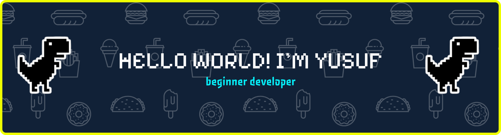

# HELLO WORLD, I'M YUSUF ANDRI 👋

### Developer in progress · Learning, building, and improving

  
  

---

## 👨‍💻 About Me

- 🌱 I’m currently learning **JavaScript** and **Laravel**.
- 💡 I enjoy exploring technology and improving my development skills.
- 🚀 This profile is where I share my learning journey and projects.

## 🛠️ Tech Stack & Tools

  

## 📊 GitHub Statistics

  
  

## 🎮 Play Games With Me

  <picture>
    <source media="(prefers-color-scheme: dark)" srcset="https://raw.githubusercontent.com/kolweoe/kolweoe/pacman-output/galaga-contribution-graph-dark.svg?game=galaga">
    <source media="(prefers-color-scheme: light)" srcset="https://raw.githubusercontent.com/kolweoe/kolweoe/pacman-output/galaga-contribution-graph.svg?game=galaga">
    
  </picture>

## 🤝 Connect With Me

  
  
  

  

