# Hi, I'm Yusuf Andri 👋

**Aspiring Developer | Learning, Building, and Growing**

  
  

---

## About Me

- 🌱 I'm currently learning **JavaScript** and **Laravel**.
- 💡 I enjoy exploring technology and improving my development skills.
- 🎨 Outside of coding, I enjoy **pixel art** and retro-inspired visuals.
- 🚀 I use this profile to document my learning journey and share projects.

## Skills & Tools

## GitHub Statistics

## Contribution Activity

<picture>
  <source media="(prefers-color-scheme: dark)" srcset="https://raw.githubusercontent.com/kolweoe/kolweoe/pacman-output/galaga-contribution-graph-dark.svg?game=galaga">
  <source media="(prefers-color-scheme: light)" srcset="https://raw.githubusercontent.com/kolweoe/kolweoe/pacman-output/galaga-contribution-graph.svg?game=galaga">
  
</picture>

## Connect With Me

<!-- Future addition: original pixel-art mascot. -->
